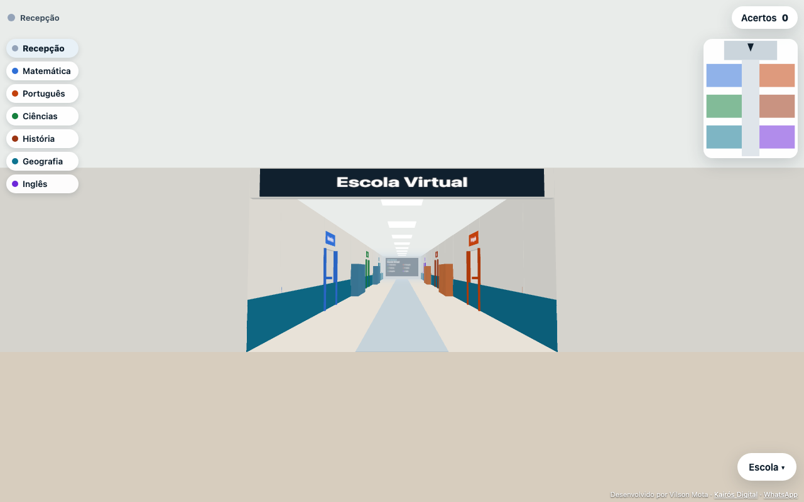

# Escola Virtual 3D

Ambiente escolar imersivo navegável em 3D: corredor, salas por disciplina, educador virtual e um conjunto completo de ferramentas de escola (minha área do aluno, secretaria, ao vivo, mensageiro, feira de reforço e biblioteca de QR codes), inspirado na estrutura de plataformas de gestão escolar.

**Demo no ar:** <https://redexglobal.github.io/escola-virtual-3d/>



## Como funciona

Você anda pela escola com **WASD/setas + mouse** no computador e com o **controle redondo na tela** no celular. No menu superior dá para ir direto a qualquer sala pelo mapa ou pelos botões. A tecla **C** (ou o botão 🎥) alterna entre **1ª pessoa e 3ª pessoa** — na 3ª você vê o seu personagem andando.

### O 3D

- Recepção, corredor e **6 salas**: Matemática, Português, Ciências, História, Geografia e Inglês.
- **Quadro de turmas na recepção**: lista as turmas oficiais com o professor; tocou numa linha, a escola anda até a sala.
- A **placa da porta** de cada sala mostra a turma real e o professor cadastrados (atualiza sozinha quando a secretaria cadastra).
- Cada sala tem quadro-negro, carteiras, TV e o **educador virtual**, que acena uma vez quando você entra, fica parado em seguida e fala a saudação com a voz do aparelho. Toque na porta, na TV ou no educador: tudo é clicável dentro da cena.
- O botão “Falar com o educador” abre uma conversa local com a IA (regras em português + voz) e sabe qual matéria você está vendo. Se houver um tutor externo configurado (`tutorUrl` em `conteudo.js`), o botão passa a abrir ele já com a disciplina.
- TV da sala toca `videos/<matéria>.mp4` se existir; sem vídeo, exibe o **último post de aula** que o professor publicou (painel Professor → Postar aula); sem as duas coisas, avisa (nada é inventado).
- Roda offline depois do primeiro carregamento (PWA) e em dispositivos móveis.

### Gamificação

Cada aluno tem um placar no topo da escola: **XP por visitar salas, responder exercícios, assistir aula, usar QR code, comprar reforço, ligar ou conversar**. Há **6 níveis** (de Calouro a Embaixador da Escola), **8 medalhas**, **missões diárias** e efeitos sonoros discretos com confete ao subir de nível. Tudo persiste no aparelho (`gamificacao.js`).

### Apresentação comercial

A página **`apresentacao.html`** é um deck 16:9 (13 slides) com as capturas reais da demo: navegação por **setas/espaco/Home/Fim** no teclado e por toque nas bordas no celular; imprime/PDF em paisagem.

### Links e QR codes por persona

A página **`links.html`** reúne os endereços de cada porta do produto, com QR codes reais: escola 3D, apresentação, painel do aluno (`#/aluno`), professor (`#/professor`), direção (`#/admin`), revendedor (`#/revendedor`) e ao vivo (`#/aovivo`). Cada link abre o portal já com o painel certo preparado.

### Os módulos da plataforma (menu “Escola ▾”)

| Módulo | O que faz |
|---|---|
| **Minha área (aluno)** | Boletim por matéria, metas, certificado (imprimível), histórico e financeiro com extrato — como kioskê do aluno |
| **Professor** | Minhas turmas com alunos matriculados, **postar aula para a TV da sala 3D**, resultados dos exercícios feitos na escola e avisos para o chat da sala |
| **Direção/Secretaria** | Visão geral (dashboard com números reais), alunos, professores, responsáveis, currículo (área > disciplina > série > subcategoria), turmas oficiais e cursos de reforço, financeiro geral, QR codes e assistente IA |
| **Revendedor** | **Convites com código de 6 caracteres** (padrão /convite/CODIGO: quem abre o link é registrado), créditos/níveis de parceiro e planos sugeridos |
| **Ao vivo** | Sala com “no ar”, chat e microfone (áudio gravado em até 15 s) |
| **Mensageiro** | Conversas com secretaria/educador/família, áudio e **ligação de voz** com avaliação de qualidade |
| **Feira** | Vitrine de cursos de reforço: compra gera matrícula, compra, extrato e aviso no chat da sala |
| **Biblioteca QR** | Gera QR codes de material; cada QR abre a sala certa na escola |

### Onde ficam os dados

Todos os dados ficam **no próprio navegador** (IndexedDB), prontos para trocar depois por um backend PHP sem refazer o 3D: toda leitura e escrita passa por uma única camada (`dados.js`) que envia eventos a cada mudança. Não há login obrigatório: cada dispositivo guarda o perfil dele. Para demonstrar, basta abrir o link e tocar em “Entrar”.

## Estrutura

```
index.html          entrada, chips de persona, HUD, telas e painéis
app.js              motor 3D (Three.js): planta, salas, câmera 1ª/3ª, clique na cena, quadros
conteudo.js         nome da escola, aulas, exercícios, saudações, créditos
dados.js            camada de dados (IndexedDB + seeds)
telas.js            painel 2D: abas, tabelas, formulários, modais, QR
modulo-aluno.js     minha área (boletim, metas, certificado, financeiro…)
modulo-secretaria.js  secretaria completa (visão geral, CRUDs, financeiro, QR, IA)
modulo-professor.js turmas, postar aula na TV, resultados, avisos
modulo-revendedor.js convites com código, créditos e planos
modulo-escola.js    ao vivo, mensageiro, feira, biblioteca QR, chat com IA
gamificacao.js      XP, níveis, medalhas, missões, HUD
links.html          hub de QR codes por persona
apresentacao.html   deck comercial 16:9 (setas/toque/impressão)
sw.js + manifest    PWA instalável, cache offline
vendor/             three.js e gerador de QR locais (sem CDN)
videos/             coloque aqui os vídeos das aulas (<matéria>.mp4)
testes/             testes automatizados (Playwright)
docs/               mapas da pesquisa de referência e capturas
```

## Rodar localmente

```bash
cd escola-virtual-3d
python3 -m http.server 8811
# abra http://localhost:8811
```

Testes (precisam do Playwright instalado):

```bash
node testes/teste-pagina.mjs   # tour completo: minha área, secretaria, ao vivo, feira, educador
node testes/teste-perfis.mjs   # sessão salva + upgrade do banco v1 antigo
node testes/teste-mobile.mjs   # iPhone simulado: entrada, secretaria, QR
node testes/teste-fase3.mjs    # câmera 1ª/3ª, gamificação, painéis, rotas #/, links e QRs
```

## Dependências

Nenhuma: Three.js vem embutido em `vendor/`, sem CDN e sem etapa de build. Os vídeos das aulas são opcionais.

---

Desenvolvido por **Vilson Mota · Kairós Digital** — <https://www.instagram.com/_kairosdigital_/> · WhatsApp: <https://wa.me/5562984924326>
